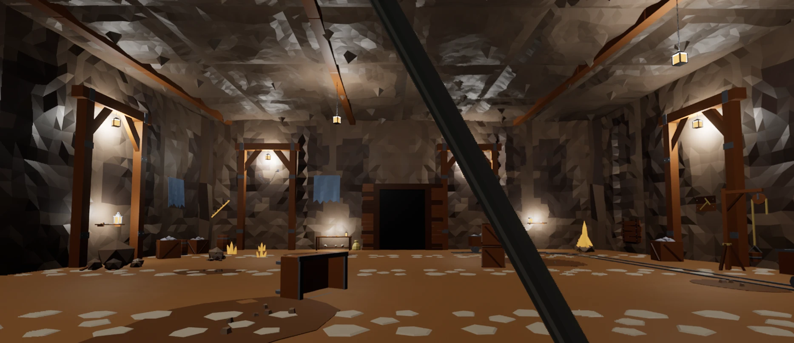

## 이번 목표

- 숲속 신전 폐허에 이어 두 번째 방을 찍어낸다.
- 첫 방에서 만든 순서(레퍼런스 → 블렌더 → 번호 스크립트로 조립)를 그대로 따라가서, 방 하나가 얼마나 빨리 나오는지 본다.

## 진행 과정

### 1. 테마 고르기: 질문은 두 번만

방을 만들 때 고를 것이 많아서, 이번엔 질문을 두 묶음으로만 받았다.

먼저 제미나이로 테마 2x2를 뽑았다. 버려진 광산 동굴, 바닷가 어촌 창고, 수확철 농가 헛간, 눈 덮인 산 망루 폐허.

첫 번째 묶음에서 전부 추천안으로 골랐다.

- 테마: 버려진 광산 동굴
- 크기: 24m (첫 방과 같음)
- 막는 방식: 울퉁불퉁한 바위벽 + 나무 보가 받치는 바위 천장, 갈라진 틈 몇 곳
- 빛: 호박색 수정과 천장 틈 햇빛

이어서 방 안쪽 콘셉트, 소품 시트(4x4), 벽 장식 시트(3x3)를 한꺼번에 보여 주고 두 번째 묶음으로 확인했다. 소품·장식은 그대로, 출구는 나무 갱도 틀 안을 검은 판으로 채운 모양.

### 2. 블렌더: 구조 14종, 소품 14종, 벽 장식 9종

블렌더 작업은 두 번에 나눠 맡겼다.

- 구조: 바닥 타일 두 종, 흙 얼룩, 4m 바위벽 두 종, 모서리 바위, 천장 판(틈 있는 것 두 종), 천장 보, 지지대 틀, 판자로 막은 입구, 출구
- 소품: 레일 직선·곡선, 광차, 엎어진 광차, 상자, 통, 곡괭이와 삽, 부서진 사다리, 돌무더기, 수정 큰 것·작은 것, 도르래, 작업대
- 벽 장식: 수정 덩이, 수정 맥, 판자 덧댄 구멍, 밧줄 고리, 선반, 푸른 천, 경고 팻말, 쇠사슬, 광석 벽감

바위벽은 방 쪽으로 최대 25cm만 튀어나오게 만들어서, 벽 장식을 벽선에서 25cm 앞에 붙이면 바위에 묻히지 않는다. 지지대 틀은 벽 조각 이음매에 세워서 이음매를 가렸다.

### 3. 언리얼 조립: 번호 스크립트 8개

`Tools/Rooms/Mine/`에 번호 스크립트를 두고 하나씩 돌렸다. 고칠 땐 그 번호 파일 위쪽의 표만 바꿔 다시 돌린다.

| 번호 | 하는 일 |
|---|---|
| 01 | FBX 임포트 |
| 02 | 개발용 맵을 복제해 레벨 만들기, 허수아비·바닥 지우기 |
| 03 | 바닥·벽·천장·지지대·입구·출구 |
| 04 | 레일과 소품 |
| 05 | 벽 장식 16개 |
| 06 | 라이팅 |
| 07 | 빛 먼지 |
| 08~09 | 랜턴과 발광 (아래에서 추가) |

레일은 북쪽 벽을 따라가다 곡선으로 꺾여 동쪽 출구 쪽으로 내려온다. 가운데 싸우는 공간에는 엎어진 광차와 상자 더미만 엄폐물로 두었다.

### 4. 밤으로 바꾸기

> 이번 맵은 밤으로 가보자 광산인데 밝으니까 좀 아쉽다. 램프들 불 라이팅 하고 안에 있는 것처럼

해와 하늘빛을 거의 끄고, 철 랜턴을 새로 만들어 지지대 8곳과 천장 보 3곳에 걸었다. 랜턴마다 불꽃 자리에 주황색 포인트 라이트를 넣었다. 첫 방에서는 랜턴 불빛을 과하다고 뺐지만, 밤 광산에서는 랜턴이 주인공이다.

> 라이팅 위치는 좋은데 조명 모델 자체에서 빛이나야지 라이팅만 하니까 따로 노는 느낌이야

블렌더에서 유리와 불꽃에 발광을 넣었는데, 언리얼로 넘어오면서 사라져 있었다. 언리얼 머티리얼에서 발광을 직접 연결하고, 호박색 수정도 은은하게 빛나게 했다.

### 5. 불빛 세기: 약하게 해 봤다가 되돌림

> 너무 빛이 쎄고 안 어울린다. 할거면 아예 어둡거나 모델 발광만 있고 라이트는 없어도 될거 같은데

라이트를 1/5 세기에 거리도 절반으로 줄이고, 더 진한 주황으로 바꿔 봤다.

> 음 전이 더 낫 전으로 하고 대신 라이트 위치를 랜턴위치라 똑같이 두자

결국 처음 세기로 돌아갔고, 라이트가 모두 랜턴 불꽃 위치에 있는 것을 숫자로 확인했다. 직접 비교해 보니 처음 것이 더 나았다.

## 문제와 해결

| 문제 | 원인 | 해결 |
|---|---|---|
| 벽 장식 시트가 신전 벽돌 시트를 고친 그림으로 나옴 | 같은 대화창에서 "wall decorations"를 앞 그림 편집으로 봄 | "벽돌·신전 말고 거친 동굴 바위 앞에"를 프롬프트에 분명히 적음 |
| 복제한 맵에 포스트 프로세스 볼륨이 없음 | 개발용 맵에 원래 없었음 | 라이팅 스크립트가 처음 한 번 만든다 |
| 랜턴 유리·수정이 안 빛남 | FBX 임포트는 블렌더 발광을 가져오지 않음 | 언리얼 머티리얼에 발광을 직접 연결 |
| 발광 유리가 하얗게 바램 | 유리가 바로 옆 자기 라이트를 받아 밝아짐 | 불꽃·유리는 빛을 받지 않는 언릿으로 바꾸고, 뒤쪽 벽보다 밝게 |
| 천장이 막혀 위에서 찍은 캡처로는 안이 안 보임 | 사방 벽과 천장으로 닫힌 방 | 방 안 두 모서리에서 찍는 캡처 스크립트를 따로 만듦 |

배운 것

- 묶음 질문 두 번으로 정하니, 나머지는 검수까지 한 번에 진행됐다.
- 불빛은 말로 정하기보다 두 버전을 직접 보고 고르는 게 빨랐다.
- 발광 색은 캡처의 픽셀 값으로 확인했다. 유리가 뒤쪽 벽보다 밝아야 빛나 보였다.

## 다음 할 일

- [ ] 세 번째 방 테마
- [ ] 방 입구 정하기 (지금은 판자로 막힌 갱도 장식뿐)
- [ ] 방과 방을 잇는 흐름 (출구로 나가면 다음 방)
